# Master Bord — Site institucional

Site da **Master Bord**, fábrica de etiquetas tecidas, bordados, patches e corte a laser em Petrópolis/RJ, no mercado desde 1994.

🌐 **No ar:** [bordado.com.br](https://bordado.com.br)

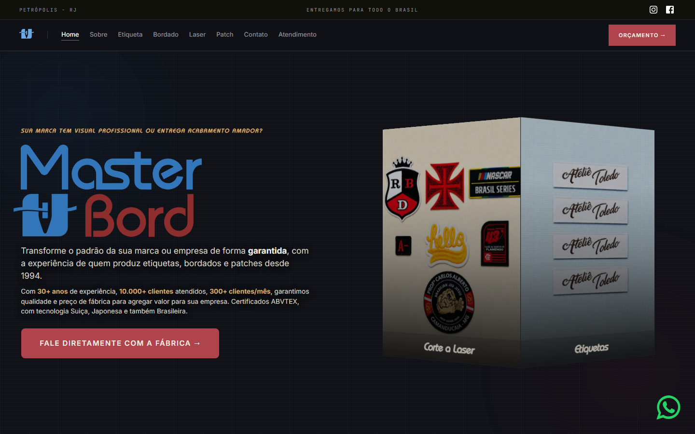

---

## Sumário

- [Prints](#prints)
- [Tecnologias usadas](#tecnologias-usadas)
- [Estrutura do projeto](#estrutura-do-projeto)
- [Como rodar localmente](#como-rodar-localmente)
- [Google Ads e Google Tag Manager](#google-ads-e-google-tag-manager)
- [Rastreio de pedidos](#rastreio-de-pedidos)
- [Créditos](#créditos)

---

## Prints

### Desktop

| Etiquetas | Bordado |
| :---: | :---: |
| 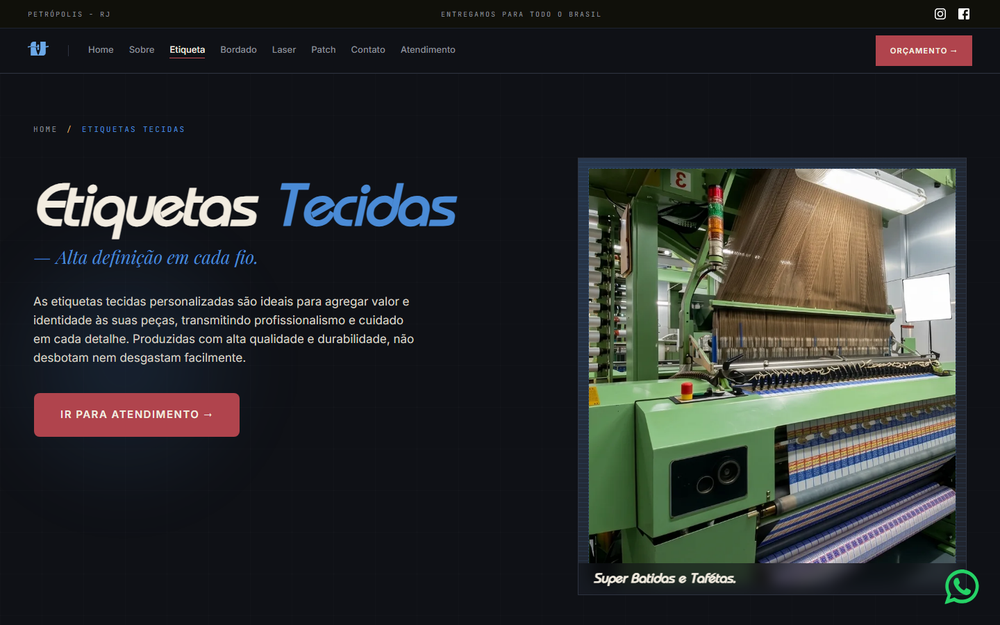 | 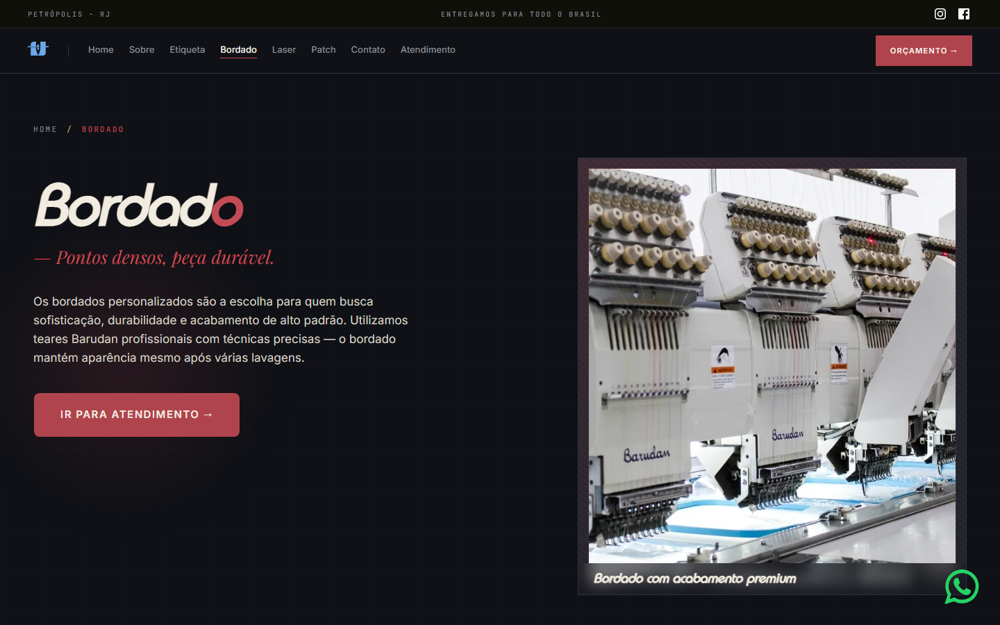 |
| **Corte a laser** | **Patch** |
| 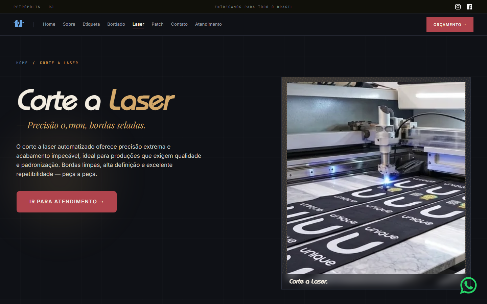 | 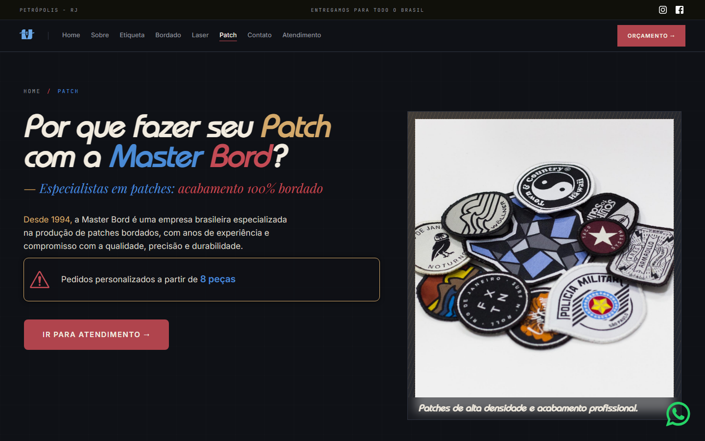 |
| **Sobre** | **Contato** |
| 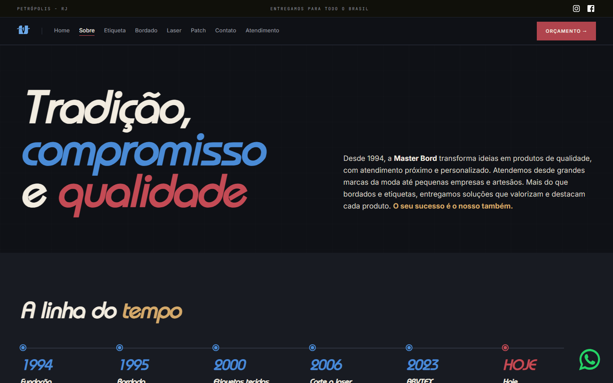 | 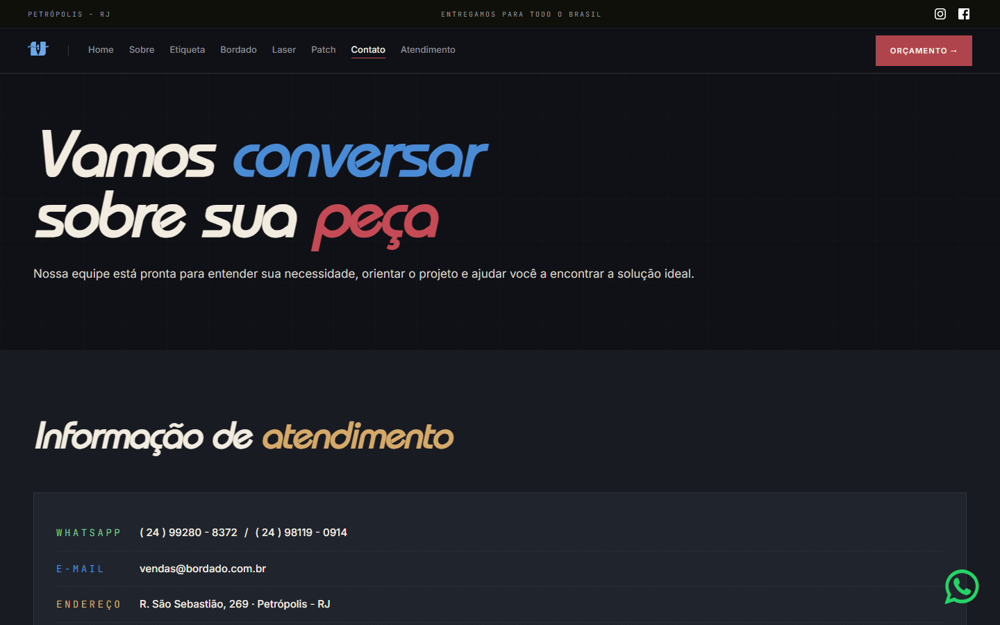 |
| **Atendimento (WhatsApp)** | **Rastreio de pedido** |
| 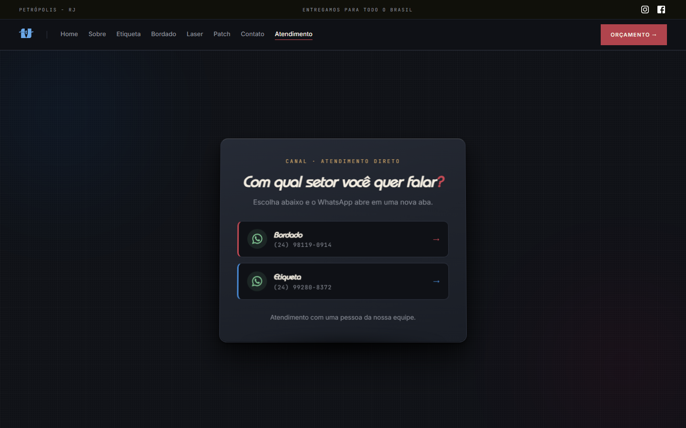 | 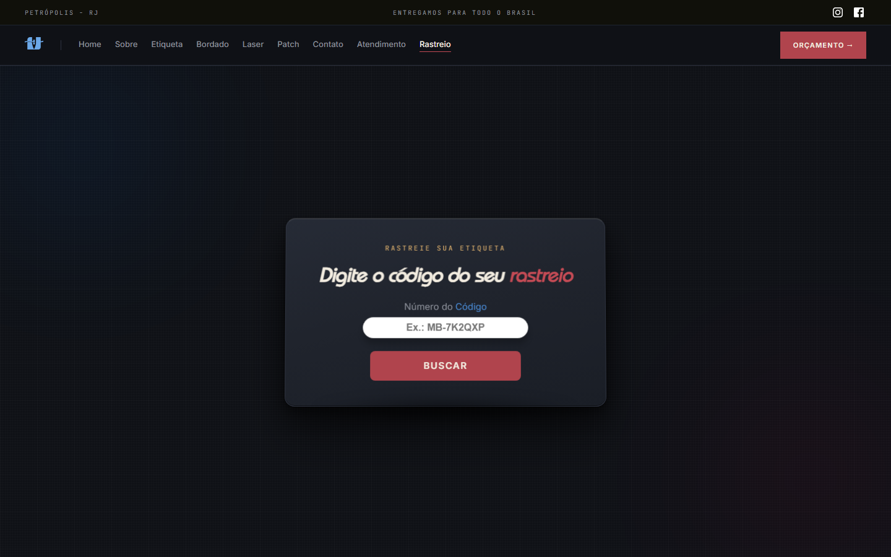 |

### Mobile

Home, Etiquetas e Atendimento em tela de celular (390px), com menu hambúrguer e botão flutuante do WhatsApp:

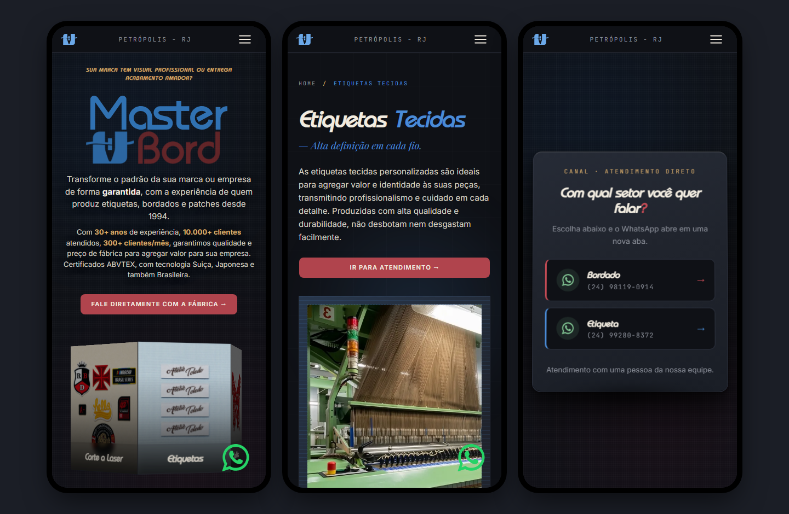

---

## Tecnologias usadas

O site é **estático**: HTML, CSS e JavaScript puros, sem framework. Isso deixa o carregamento rápido (bom para o Lighthouse e para o Google Ads) e permite hospedar em qualquer servidor.

| Tecnologia | Para que serve no projeto |
| --- | --- |
| **HTML5 semântico** | Uma página `.html` por seção do site (home, produtos, sobre, contato, atendimento, rastreio, políticas). |
| **CSS3** com aninhamento (*nesting*) | Estilos escritos em `css-fonte/`, organizados por página, com nomes de classe no padrão BEM (`bloco__elemento--modificador`). |
| **PostCSS** + `postcss-preset-env` | Converte o CSS aninhado de `css-fonte/` em CSS compatível em `css/`, para funcionar também em navegadores antigos (Chrome/Edge 109 e Firefox 115, últimos do Windows 7). |
| **JavaScript puro (vanilla)** | Cabeçalho que muda ao rolar, menu hambúrguer, modal do WhatsApp, carrossel infinito de logos de clientes, cubo 3D giratório da home e o rastreio de pedidos. |
| **Imagens WebP + SVG** | Fotos em WebP (mais leves); logo e ícones em SVG, desenhados via `mask-image` para herdar a cor do CSS. |
| **Google Ads (gtag.js)** | Tag de remarketing/conversão `AW-627331568` em todas as páginas. |
| **Google Tag Manager** | Contêiner `GTM-KSTH4P9J` em todas as páginas, para gerenciar tags e conversões pelo painel, sem mexer no código. |
| **WhatsApp (`wa.me`)** | Links diretos para os setores de Bordado e Etiqueta com mensagem pronta. |
| **SEO** | `sitemap.xml`, `robots.txt`, `canonical`, meta description, Open Graph e favicons. |

---

## Estrutura do projeto

```
Site-Master-Bord/
├── index.html               # Home
├── produtos.html            # Visão geral dos produtos
├── produto-etiqueta.html    # Etiquetas tecidas
├── produto-bordado.html     # Bordados
├── produto-laser.html       # Corte a laser
├── patch.html               # Patches bordados
├── sobre.html               # História da empresa
├── contato.html             # Contato e endereço
├── atendimento.html         # Escolha do setor no WhatsApp (página de destino dos anúncios)
├── rastreio.html            # Rastreio de pedido pelo código MB-XXXXXX
├── politicas.html           # Políticas e termos
├── fale-conosco/index.html  # Redireciona o endereço do site antigo para contato.html
│
├── css-fonte/               # ✏️ CSS que se EDITA (com aninhamento)
│   └── responsivo/          #    versões mobile/desktop de cada página
├── css/                     # ⚙️ CSS gerado pelo PostCSS (não editar à mão)
├── js/
│   ├── global.js            # Cabeçalho, menu mobile, modal do WhatsApp
│   ├── index.js             # Carrossel de clientes e cubo 3D da home
│   └── rastreio.js          # Busca e linha do tempo do pedido
├── img/                     # Fotos (WebP), logos de clientes e SVGs
├── docs/prints/             # Prints usados neste README
├── sitemap.xml
├── robots.txt
├── package.json             # Scripts do PostCSS
└── postcss.config.js
```

---

## Como rodar localmente

**Pré-requisito:** [Node.js](https://nodejs.org) (só para converter o CSS).

```bash
# 1. Instalar as dependências do PostCSS
npm install

# 2. Enquanto edita: converte o CSS a cada arquivo salvo
npm run watch:css

# 3. Antes de subir o site: converte tudo uma vez
npm run build:css
```

> ⚠️ **Edite só a pasta `css-fonte/`.** A pasta `css/` é refeita a cada conversão e qualquer alteração feita nela à mão se perde.

Para abrir o site, use um servidor local (abrir o `.html` direto pelo explorador de arquivos não carrega a logo da home nem o rastreio, porque o navegador bloqueia `mask-image` e `fetch` em `file://`):

```bash
python -m http.server 8000
# depois abra http://localhost:8000
```

Ou use a extensão **Live Server** do VS Code.

---

## Google Ads e Google Tag Manager

O site foi preparado para receber tráfego de **anúncios do Google Ads** e transformar visitas em **conversas no WhatsApp**. Essa parte foi feita com a ajuda do **Pedro**.

### Fluxo do cliente

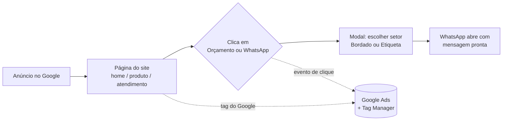

### Passo a passo do que foi feito

**1. Site no ar** — *16/09/2026*
Limpeza dos arquivos antigos e publicação do site no domínio `bordado.com.br`.

**2. Ajustes de desempenho (Lighthouse)** — *22/09/2026*
Ajustes guiados pelo Google Lighthouse. Página rápida melhora o Índice de Qualidade do anúncio e reduz o custo por clique.

**3. Mensagem pronta no WhatsApp** — *22/09/2026*
Todos os links do WhatsApp passaram a abrir com o texto:

> Olá! Vim pelo site e gostaria de solicitar um orçamento gratuito.
>
> Gostaria de conversar com um consultor para entender a melhor solução para a minha necessidade.

Assim a equipe de vendas sabe na hora que o contato **veio pelo site/anúncio**. No código, a mensagem fica em `js/global.js`:

```js
const WA_TEXTO = encodeURIComponent(
  'Olá! Vim pelo site e gostaria de solicitar um orçamento gratuito.\n\n' +
  'Gostaria de conversar com um consultor para entender a melhor solução para a minha necessidade.'
);
// ...
href="https://wa.me/${WA_BORDADO}?text=${WA_TEXTO}"
```

**4. Tag do Google Ads e Google Tag Manager** — *23/09/2026*
Os dois códigos foram colocados no `<head>` de **todas** as páginas, logo no início, para medir toda visita:

```html
<!-- Google tag (gtag.js) — Google Ads -->
<script async src="https://www.googletagmanager.com/gtag/js?id=AW-627331568"></script>
<script>
  window.dataLayer = window.dataLayer || [];
  function gtag() { dataLayer.push(arguments); }
  gtag('js', new Date());
  gtag('config', 'AW-627331568');
</script>

<!-- Google Tag Manager -->
<script>
  (function (w, d, s, l, i) { /* ... */ })(window, document, 'script', 'dataLayer', 'GTM-KSTH4P9J');
</script>
```

E logo após a abertura do `<body>`, o `<noscript>` do Tag Manager (para quem navega sem JavaScript):

```html
<noscript>
  <iframe src="https://www.googletagmanager.com/ns.html?id=GTM-KSTH4P9J"
          height="0" width="0" style="display: none; visibility: hidden"></iframe>
</noscript>
```

- **gtag.js (`AW-…`)** — liga o site à conta do Google Ads: registra as visitas vindas dos anúncios e monta listas de remarketing.
- **Tag Manager (`GTM-…`)** — as regras de conversão (como clique no botão do WhatsApp) ficam no painel do GTM. Para criar ou mudar uma conversão **não é preciso alterar o código** do site.

**5. Página de destino `atendimento.html`**
Página simples e direta, com uma só ação: escolher o setor (Bordado ou Etiqueta) e abrir o WhatsApp. É a página ideal para apontar os anúncios, pois tem pouca distração e leva direto à conversão.

**6. Endereço antigo redirecionado**
`fale-conosco/index.html` redireciona quem chega pelo endereço do site antigo (anúncios, links salvos ou resultados do Google) para `contato.html`, sem página de erro.

**7. SEO para o Google**
`sitemap.xml` e `robots.txt` publicados, além de `canonical`, *meta description* e Open Graph em cada página.

### Como verificar se as tags estão funcionando

1. Instale a extensão [Google Tag Assistant](https://tagassistant.google.com/) no Chrome.
2. Abra `https://bordado.com.br` e conecte o Tag Assistant.
3. Devem aparecer as tags **`AW-627331568`** e **`GTM-KSTH4P9J`**.
4. Clique em um botão do WhatsApp e confira se o evento aparece no Tag Assistant e, depois de algumas horas, em **Google Ads → Metas → Conversões**.

---

## Rastreio de pedidos

A página `rastreio.html` mostra em que etapa está o pedido do cliente: **Recebido → Em produção → Finalizado → Enviado** (ou *Pronto para retirada*).

- O cliente digita o código (ex.: `MB-7K2QXP`) ou abre o link `rastreio.html?p=MB-7K2QXP` enviado pelo WhatsApp.
- O `js/rastreio.js` busca o arquivo `pedidos/MB-7K2QXP.json`, gerado pelo sistema interno **TEAR**, e monta a linha do tempo.
- Os JSON só têm datas e o nome da etiqueta, **nenhum dado pessoal do cliente**.
- A pasta `pedidos/` está no `.gitignore`: os arquivos são enviados direto ao servidor, uma vez por dia.
- Se o arquivo estiver com mais de 2 dias sem atualização, o site avisa em vez de mostrar dado antigo como atual.

---

## Créditos

- **Davi Barbosa** — desenvolvimento do site (layout, HTML, CSS, JavaScript, responsividade e rastreio).
- **Pedro** — ajuda com o código e com a configuração do **Google Ads**: publicação do site, mensagem pronta do WhatsApp e preparação para os anúncios.

---

© Master Bord · Petrópolis/RJ · desde 1994
